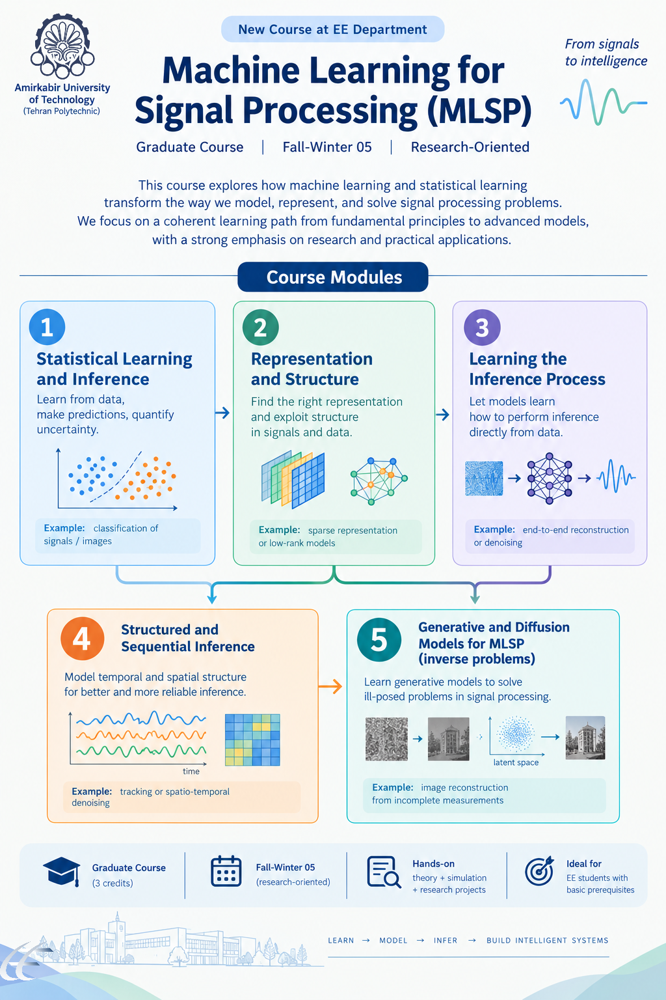
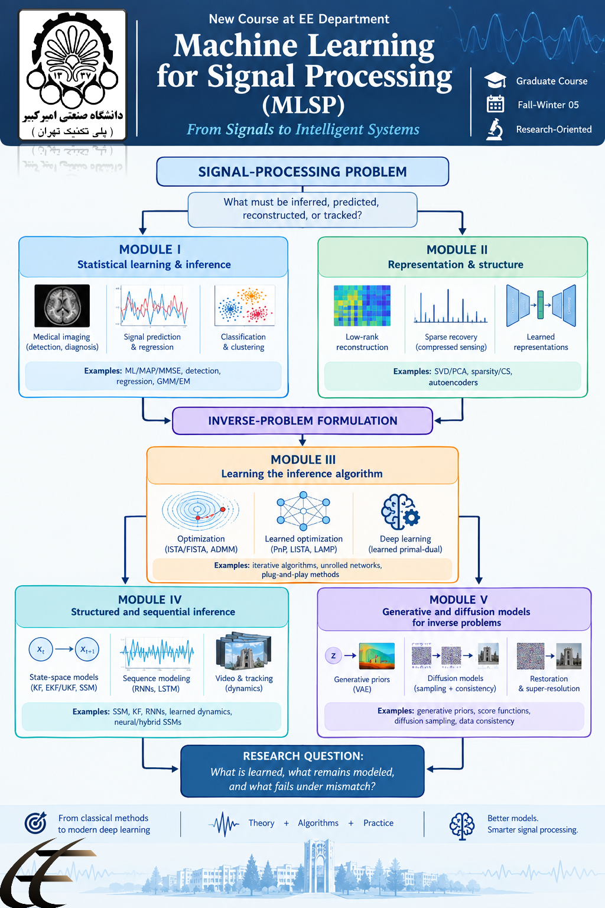

# Machine Learning for Signal Processing (MLSP)

<p align="center">
  
</p>

<p align="center">
  
</p>

<p align="center">
  <strong>Graduate Course | Amirkabir University of Technology (Tehran Polytechnic)</strong><br>
  <strong>Instructor:</strong> Dr. Mahdi Shamsi
</p>

---

## About the Course

This repository is the official course repository for **Machine Learning for Signal Processing (MLSP)** at **Amirkabir University of Technology (Tehran Polytechnic)**.

This course is introduced as the **first formal MLSP course taught in Iran**, offered at **Amirkabir University** for **graduate students**, and taught by **Dr. Mahdi Shamsi**.

MLSP studies how machine learning can be integrated with the **mathematical models, structures, and algorithms of signal processing**. Rather than treating machine learning as a disconnected collection of algorithms, this course follows a unified question:

> **What should be learned, and what should remain modeled?**

The course builds a coherent path from:

- statistical inference,
- signal structure and representation,
- inverse problems and optimization,
- learned inference algorithms,
- structured and sequential inference,
- to modern generative and diffusion models for inverse problems.

---

## Course Vision

Signal processing and machine learning should not be treated as separate worlds.

This course teaches students how to reason from:

**signal-processing problem → structure → inference formulation → model-based algorithm → learned component → controlled evaluation**

The goal is not just to obtain good numerical performance, but to understand:

- what assumptions are being made,
- what structure is being exploited,
- what part of the system is learned,
- and under what conditions a method succeeds or fails.

---

## Course at a Glance

- **Course title:** Machine Learning for Signal Processing (MLSP)
- **Level:** Graduate
- **Institution:** Amirkabir University of Technology (Tehran Polytechnic)
- **Instructor:** Dr. Mahdi Shamsi
- **Credits:** 3 graduate credits
- **Duration:** 16 instructional weeks
- **Weekly structure:** 2 hours lecture + 1 hour TA / recitation / lab
- **Primary implementation environment:** Python
- **Main software stack:** NumPy, SciPy, Matplotlib, scikit-learn, PyTorch

---

## Why This Course Matters

This repository accompanies a course designed to help students move:

- from **classical model-based methods**
- toward **modern learning-based and hybrid intelligent systems**,

while preserving the strong engineering identity of signal processing.

The course is especially relevant for students and researchers interested in:

- inverse problems,
- sparse recovery,
- sensor fusion,
- estimation and detection,
- sequential inference,
- learned optimization,
- signal reconstruction,
- learned dynamics,
- generative priors and diffusion methods.

Applications span areas such as:

- communications,
- biomedical engineering,
- robotics,
- radar / sonar,
- imaging,
- control,
- and industrial monitoring.

---

## Course Modules

### Module I — Statistical Learning & Inference
Learn how to formulate signal-processing tasks using statistical inference principles.

Topics include:
- ML / MAP / MMSE
- detection and regression
- logistic regression / LDA
- GMM / EM (supporting topic)

---

### Module II — Representation & Signal Structure
Learn how structure makes inference easier.

Topics include:
- SVD / PCA
- low-rank models
- sparsity and compressed sensing
- autoencoders and learned representations

---

### Module III — Learning the Inference Algorithm
The signature MLSP module.

Topics include:
- inverse problems
- proximal optimization
- ISTA / FISTA
- Plug-and-Play (PnP)
- algorithm unrolling
- LISTA and related learned inference methods

---

### Module IV — Structured & Sequential Inference
Study temporal and dynamical signal models.

Topics include:
- state-space models
- Kalman filtering
- EKF / UKF
- nonlinear filtering
- learned dynamics
- recurrent and hybrid state-space models

---

### Module V — Generative & Diffusion Models for Inverse Problems
Study modern learned priors for reconstruction and inference.

Topics include:
- generative priors
- score-based models
- diffusion models
- posterior sampling
- reconstruction with learned priors

---

## Learning Outcomes

By the end of the course, students should be able to:

- formulate signal-processing problems using statistical, Bayesian, and optimization-based inference;
- exploit low-rank, sparse, subspace, and learned representations;
- understand proximal optimization, Plug-and-Play methods, and algorithm unrolling for learned inference;
- connect state-space models and Kalman filtering with learned recurrence and learned state-space models;
- understand generative, score-based, and diffusion models as learned priors for inverse problems;
- conduct reproducible experiments with appropriate baselines, controlled comparisons, and failure analysis.

---

## Target Audience

This course is intended for:

- graduate students in Electrical Engineering and related fields,
- early-stage researchers working on sensing, estimation, reconstruction, prediction, and structured data,
- students interested in combining **signal models** with **machine learning** in a principled way.

---

## Prerequisites

Required background:

- linear algebra
- probability
- signals and systems
- multivariable calculus
- basic optimization and gradient descent
- basic Python programming

Helpful but not required:

- SVD and numerical linear algebra
- Fourier / transform methods
- previous ML / DL exposure
- Jupyter / scientific Python familiarity

> Previous machine-learning or deep-learning coursework is **not required**.

---

## Repository Purpose

This repository serves two purposes:

1. **Student-facing course resource**  
   A clean and structured source for lecture-aligned materials, labs, assignments, and project support.

2. **Shared course infrastructure**  
   A common source of truth maintained by the teaching team for reproducible, high-quality educational material.

This means the repository is designed to be useful not only during the semester, but also as a **long-term reference for students**.

---

## Repository Structure

```text
MLSP-course/
├── README.md
├── environment.yml
├── requirements.txt
├── .gitignore
│
├── docs/
│   ├── assets/
│       ├── poster-overview.png
│       ├── poster-modules.png
│       └── MLSP_Course_Summary.pdf
│
├── lectures/
│   ├── week01/
│   ├── week02/
│   └── ...
│
├── labs/
│   ├── week00_environment/
│   ├── week01_detection/
│   ├── week02_nn_spectral/
│   ├── week03_pca_cca/
│   ├── week04_sparse_nmf/
│   ├── week05_inverse/
│   ├── week06_ista/
│   ├── week07_unfolding/
│   ├── week08_pnp_red/
│   ├── week09_kalman/
│   ├── week10_identification/
│   ├── week11_neural_ssm/
│   ├── week12_learned_priors/
│   ├── week13_diffusion/
│   ├── week14_pinn/
│   ├── week15_fno/
│   └── week16_project/
│
├── assignments/
│   ├── HW1_learning_from_signals/
│   ├── HW2_signal_structure/
│   ├── HW3_learning_inference/
│   └── HW4_learning_dynamics/
│
├── datasets/
    ├── README.md
    ├── download_scripts/
    └── metadata/


````

---

## How to Use This Repository

Students can use this repository in several ways:

* follow the weekly lecture / tutorial / lab flow;
* run reference implementations and experiments;
* review mathematical baselines;
* compare classical and learned methods;
* reuse templates for homework and final projects;
* study reproducible scientific workflows.

Recommended learning path:

1. Read lecture notes / slides
2. Review the tutorial for the core mathematical idea
3. Run the lab notebook
4. Complete the assignment
5. Reuse or extend the implementation in the final project

---

## Weekly Course Progression

| Weeks | Module     | Main theme                                                    |
| ----- | ---------- | ------------------------------------------------------------- |
| 1–3   | Module I   | Statistical learning, inference, detection, regression        |
| 4–6   | Module II  | Representation, low-rank models, sparsity, compressed sensing |
| 7–10  | Module III | Inverse problems, proximal optimization, learned inference    |
| 11–13 | Module IV  | Sequential inference, Kalman filtering, learned dynamics      |
| 14–16 | Module V   | Generative priors, score-based models, diffusion methods      |

---

## Assessment Philosophy

The course emphasizes four abilities:

1. **Understand** — explain foundations clearly
2. **Derive** — connect assumptions, objectives, and algorithms
3. **Implement** — reproduce representative methods
4. **Analyze** — compare methods and identify assumptions, limitations, and failure modes

The educational emphasis is not merely on achieving lower numerical error, but on explaining:

* why a method works,
* what it assumes,
* how it compares to a baseline,
* and when it fails.

---

## Research Question at the Heart of the Course

A central question runs throughout MLSP:

> **What is learned, what remains modeled, and what fails under mismatch?**

This question unifies the entire course.

---

## Installation

### Clone the repository

```bash
git clone <repository-url>
cd MLSP-course
```

### Create the environment

Using conda:

```bash
conda env create -f environment.yml
conda activate mlsp
```

Or using pip:

```bash
pip install -r requirements.txt
```

---

## Recommended Software Stack

Core tools used in the course include:

* NumPy
* SciPy
* Matplotlib
* scikit-learn
* PyTorch
* Jupyter

Additional libraries may be used depending on the module or project topic.

---

## Suggested References

Core references include:

* S. Haykin, *Adaptive Filter Theory*
* A. H. Sayed, *Adaptive Filters*
* S. Kay, *Fundamentals of Statistical Signal Processing*
* C. M. Bishop, *Pattern Recognition and Machine Learning*
* K. P. Murphy, *Machine Learning: A Probabilistic Perspective*

Supplementary references and research papers will be provided throughout the semester.

---

## For Teaching Assistants

This repository is shared among the teaching assistants and is expected to remain:

* structured,
* reproducible,
* well-documented,
* and consistent with the course philosophy.

All TAs should preserve the lecture → tutorial → lab → homework connection and maintain this repository as a reliable source for students.

---

## Acknowledgment

This repository accompanies the MLSP course offered at:

**Amirkabir University of Technology (Tehran Polytechnic)**
**Electrical Engineering Department**
**Instructor: Dr. Mahdi Shamsi**

It is intended as both:

* a teaching resource for the current offering,
* and a lasting academic resource for future students interested in Machine Learning for Signal Processing.

---

## Course Summary

A short course summary is available here:

[MLSP Course Summary (PDF)](docs/assets/MLSP_Course_Summary.pdf)

---

